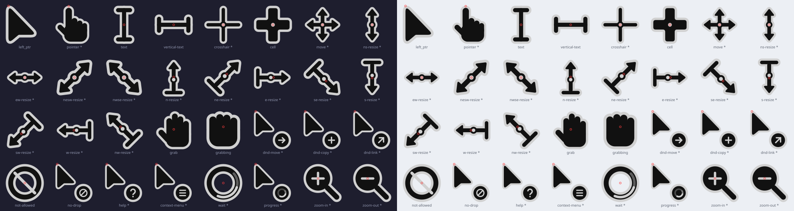

<div align="center">

# Haku Cursor

**A minimal, geometric XCursor theme: near-black silhouette, one small accent. Generated entirely from code.**



<sub>Red dots mark each cursor's hotspot. Preview itself is generated by `make preview`.</sub>

</div>

> **Authorship.** This whole project (cursor geometry, SVG/PNG/XCursor generator, build and install scripts, Nix files, and this README) was designed and written by **Claude**, Anthropic's AI assistant, in an interactive coding session.
> No AI image generation was used: every cursor is drawn by Python code, and nothing is copied or traced from any other cursor theme.

## Contents

[Quick start](#quick-start) · [Design](#design) · [Cursors](#cursors) · [Dependencies](#dependencies) · [Build](#build) · [Install](#install) · [Try it](#try-it) · [Custom accent](#custom-accent) · [Project layout](#project-layout) · [Known limitations](#known-limitations)

## Quick start

```bash
nix-shell            # NixOS; elsewhere install python3, librsvg, xcursorgen, make
make                 # build all 8 accent themes into dist/
make install THEME=blue
gsettings set org.gnome.desktop.interface cursor-theme 'Haku-Blue'
```

The pipeline is fully code-driven. SVG, PNG and XCursor binaries are *generated artifacts*: never edit them by hand, change the code and rebuild.

```
Python geometry  →  SVG  →  PNG (re-rasterised from the vector at every size)  →  xcursorgen  →  XCursor theme
```

## Design

### Principles

1. **Silhouette first.** Every cursor must be recognisable as a single dark shape at 24 px.
2. **One accent per cursor.** The accent colour marks the *point of action or state* (a pip, an inlay, a badge glyph, a spinner arc) and never fills a whole shape.
3. **Visible on any background.** A thin light outline hugs the black silhouette, so the cursor does not disappear on dark wallpapers.
4. **Geometry, not illustration.** Polygons with softly rounded corners, round-capped strokes, no gradients, no shadows.
5. **One design system.** All cursors share the same tokens; none is designed in isolation.

### Anatomy of a cursor

```
┌─ outline ──── theme.outline  (#f2f2f2)   thin light edge around the union of all black shapes
├─ silhouette ─ theme.base     (#111111)   the main shape(s)
└─ accent ───── theme.accent   (preset)    one small detail on top
```

Outlines are drawn per cursor as a "halo" behind *all* body shapes first, so overlapping parts (fingers, shaft + arrowhead) merge into one clean silhouette instead of showing internal seams.

### Coordinate system

Every cursor is drawn on a fixed **100 × 100 canvas** in normalised units, serialised to SVG once, then rasterised separately for each pixel size (24, 32, 48, 64, 96 by default). Shapes are never scaled as bitmaps, so proportions stay exact. Hotspots live in a single place (`CURSORS` in `src/cursors.py`) and are converted to pixels with `floor(h · size / 100)`.

### Tokens (`src/geometry.py`, `config/palettes.json`)

| Token | Value | Used for |
|---|---|---|
| `base` | `#111111` | silhouette |
| `outline` | `#f2f2f2` | light edge |
| `accent` | preset or custom | the single small accent |
| `OUTLINE` | 2.2 | outline thickness, measured outside the silhouette |
| `STROKE_MAIN` | 6 | shafts, I-beam, primary lines |
| `STROKE_MINOR` | 3 | separators, badge glyphs |
| `CORNER_RADIUS` | 3.4 | default polygon rounding |
| `PIP_DISC_R` / `PIP_DOT_R` | 6.2 / 3.2 | dark disc + accent dot at the centre of precision, move and resize cursors |
| `BADGE_R` | 15 | round badge used by drag, help, progress and no-drop cursors |

### Where the accent goes

| Cursor family | Accent detail |
|---|---|
| Arrow (`left_ptr`) | inlay line along the tail |
| Hands (`pointer`, `grab`, `grabbing`) | cuff line at the wrist |
| I-beam (`text`) | caret segment on the stem |
| `crosshair`, `cell`, `move`, resize | pip at the centre |
| Badge cursors (`dnd-*`, `help`, `no-drop`, `context-menu`) | glyph inside the badge |
| `wait`, `progress` | rotating arc (head 95°, fading tail) |
| `not-allowed` | diagonal slash |
| `zoom-in`, `zoom-out` | plus / minus inside the lens |

## Cursors

32 real assets plus 68 aliases created as relative symlinks (no duplicated binaries).

| Group | Assets | Main aliases |
|---|---|---|
| Normal | `left_ptr` | `default` `arrow` `top_left_arrow` |
| Link | `pointer` | `hand` `hand1` `hand2` `pointing_hand` `link` |
| Text | `text` `vertical-text` | `xterm` `ibeam` |
| Precision | `crosshair` `cell` | `cross` `tcross` `plus` |
| Move | `move` | `all-scroll` `fleur` `size_all` |
| Resize | `n/s/e/w-resize` · `ne/nw/se/sw-resize` · `ns/ew/nesw/nwse-resize` | `top_side` `bottom_left_corner` `sb_h_double_arrow` `col-resize` `fd_double_arrow` … |
| Drag | `grab` `grabbing` `dnd-move` `dnd-copy` `dnd-link` | `openhand` `closedhand` `copy` `alias` |
| State | `not-allowed` `no-drop` `help` `context-menu` | `forbidden` `crossed_circle` `question_arrow` |
| Loading (12 frames, 80 ms) | `wait` `progress` | `watch` · `left_ptr_watch` `half-busy` |
| Zoom | `zoom-in` `zoom-out` | `zoom_in` `zoom_out` |

Legacy 32-character hash names used by old X11 builds are listed in `HASH_ALIASES` (`src/cursors.py`). Only mappings confirmed by public documentation are included (Arch Wiki *Cursor themes*, a Gentoo forum thread on xcursor symlinks). Modern toolkits (GTK 3/4, Qt 5/6, Firefox, Chromium) request CSS names and do not need them.

## Dependencies

| Needed | Role | Notes |
|---|---|---|
| `python3` ≥ 3.10 | generator | standard library only |
| `rsvg-convert` (librsvg) | SVG → PNG | alternatives: `resvg`, `inkscape` (CLI only, no GUI) |
| `xcursorgen` | PNG → XCursor | |
| `make` | build driver | optional |
| `Pillow` | fallback only | used when no SVG renderer or `xcursorgen` is on `PATH` |

All binaries are resolved through `PATH` (`shutil.which`); nothing is hardcoded to `/usr/bin`. If `rsvg-convert` or `xcursorgen` is missing, the generator prints a `note:` and falls back to a built-in Pillow rasteriser and a pure-Python XCursor writer. Force a backend with `--renderer` / `--xcursorgen`.

### NixOS

```bash
nix-shell            # uses the bundled shell.nix
make
```

Minimal equivalent:

```nix
pkgs.mkShell {
  packages = with pkgs; [
    python3
    gnumake
    librsvg        # provides rsvg-convert
    xcursorgen     # nixpkgs >= 25.05; older releases: xorg.xcursorgen
  ];
}
```

As a package (home-manager). The bundled `default.nix` has **not yet been tested on a machine with Nix**:

```nix
home.pointerCursor = {
  package = pkgs.callPackage /path/to/haku-cursor { };
  name = "Haku-Blue";
  size = 24;
  gtk.enable = true;
};
```

## Build

```bash
make                  # every accent theme  -> dist/Haku-*
make blue             # one theme (blue cyan green purple pink red orange yellow)
make preview          # generated/preview.svg + preview.png
make verify           # check XCursor structure, hotspots, animation, symlinks
make clean
make SIZES=extended   # 16 20 24 28 32 40 48 56 64 72 96  (default: 24 32 48 64 96)
```

Or call the generator directly:

```bash
python src/generate.py --palette blue
python src/generate.py --all
python src/generate.py --sizes 24,32,48 --palette green
python src/generate.py --list
```

## Install

Installs to `~/.local/share/icons`, no root needed:

```bash
make install THEME=blue        # or ./scripts/install.sh blue
make install                   # every built theme
make uninstall THEME=blue
```

## Try it

GTK / GNOME:

```bash
gsettings set org.gnome.desktop.interface cursor-theme 'Haku-Blue'
gsettings set org.gnome.desktop.interface cursor-size 24
```

Quick test of a single app without touching system settings:

```bash
XCURSOR_THEME=Haku-Blue XCURSOR_SIZE=24 <some-app>
```

Wayland compositors (set the environment variables too, so XWayland, Qt and Electron apps agree):

| Compositor | Configuration |
|---|---|
| Hyprland | `env = XCURSOR_THEME,Haku-Blue` · `env = XCURSOR_SIZE,24` · `exec-once = hyprctl setcursor Haku-Blue 24` |
| Niri | `cursor { xcursor-theme "Haku-Blue"; xcursor-size 24 }` in `config.kdl` |
| Sway | `seat seat0 xcursor_theme Haku-Blue 24` |
| Plain GTK | `~/.config/gtk-3.0/settings.ini` and `gtk-4.0`: `gtk-cursor-theme-name=Haku-Blue`, `gtk-cursor-theme-size=24` |
| X11 | `~/.Xresources`: `Xcursor.theme: Haku-Blue` and `Xcursor.size: 24` |

Flatpak apps need access to the icon directory: `flatpak override --user --filesystem=~/.local/share/icons:ro`.
Hyprland's native `hyprcursor` is a different format; this theme is XCursor, which Hyprland falls back to.

## Custom accent

```bash
python src/generate.py --accent "#7aa2f7" --name Haku-Tokyo
python src/generate.py --name Haku-Mono --accent "#d0d0d0" --base "#000000"
```

Preset colours live in `config/palettes.json`; adding a line there adds a new theme and a new `make <name>` target.

## Project layout

```
src/svg.py        scene graph + SVG serialiser (groups, transforms, path, arc, text)
src/geometry.py   design tokens, rounded_polygon, halo/silhouette, arrowhead, badge, spinner
src/cursors.py    cursor drawings + registry (hotspot, frames, aliases)
src/palettes.py   loads config/palettes.json, Theme, custom accents
src/generate.py   CLI + pipeline (SVG → PNG → xcursorgen → symlinks → index.theme)
src/preview.py    preview sheet           src/verify.py   checks built themes
src/raster.py     fallback rasteriser     src/xcursor.py  fallback XCursor reader/writer
config/palettes.json          base, outline and accent presets
generated/<Theme>/{svg,png}   intermediate artifacts
build/<Theme>/*.conf          xcursorgen configs
dist/<Theme>/                 finished themes
```

To add a cursor, write `draw_xxx(theme, t) -> Group` in `cursors.py` and add one `CursorSpec(name, draw, hotspot, group, aliases=...)` entry.

## Known limitations

- **Not yet tested on a real desktop.** The development sandbox had neither `rsvg-convert` nor `xcursorgen`. The Pillow + pure-Python path was built and checked with `make verify` (file headers match real Adwaita cursors); the `rsvg-convert` + `xcursorgen` path was only checked with stub programs for argument handling. After your first build, run `make verify` and look at `make preview`.
- At 24 px, thin strokes and the light outline sit close together; there is no pixel-grid hinting yet.
- Missing: `right_ptr`, `pencil`, `color-picker`, dedicated `col-resize` / `row-resize` (currently aliases of `ew-resize` / `ns-resize`), Windows `.cur` export, native hyprcursor output.

## License

MIT. See [LICENSE](LICENSE).