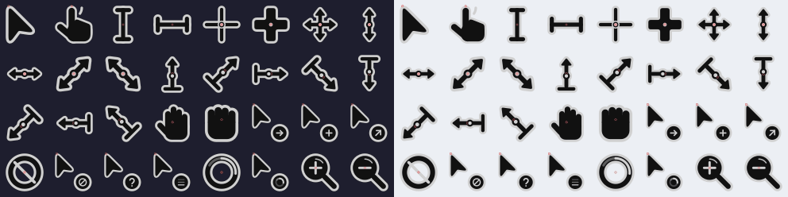
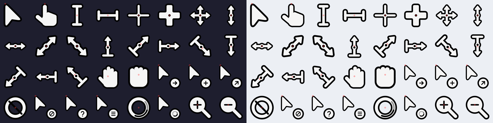
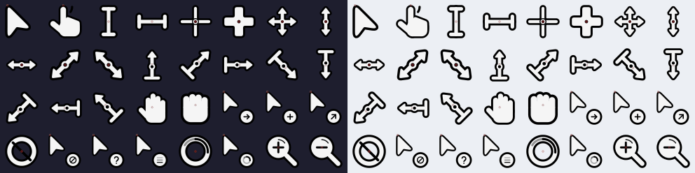

# Haku Cursor

A geometric XCursor theme with 32 cursors, 24 animations and two colours per cursor.

- **Haku-Dark:** dark fill with a grey-white accent (`#d0d0d0`).
- **Haku-Light:** light fill with a black accent (`#000000`).

Only these two themes are built and installed by default. Extra colours are optional.

## Preview

**Dark**




**Light**





Red rings mark hotspots.
GIFs show the animations on dark and light backgrounds. Run `make preview` to regenerate them (requires Pillow).

## Install

Requires Python 3.10+, Make, librsvg (`rsvg-convert`) and `xcursorgen`. On NixOS, run `nix-shell` first.

```bash
make
make install
```

Installs `Haku-Dark` and `Haku-Light` into `~/.icons/`, without root. To install just one, use `make install THEME=dark` or `THEME=light`.

For an extra colour, build and install it explicitly:

```bash
./scripts/build.sh blue
./scripts/install.sh blue
```

Colours: `blue cyan green purple pink red orange yellow`. The example installs `Haku-Blue` and `Haku-Blue-Light`.

## Setup

Select `Haku-Dark` or `Haku-Light` in your desktop's cursor settings. Installing does not activate a theme automatically.

For GNOME:

```bash
gsettings set org.gnome.desktop.interface cursor-theme 'Haku-Dark'
gsettings set org.gnome.desktop.interface cursor-size 24
```

For Wayland, also set `XCURSOR_THEME=Haku-Dark` and `XCURSOR_SIZE=24` in your session environment.

| Desktop / compositor | Configuration |
|---|---|
| Hyprland | `env = XCURSOR_THEME,Haku-Dark` · `env = XCURSOR_SIZE,24` · `exec-once = hyprctl setcursor Haku-Dark 24` |
| Niri | `cursor { xcursor-theme "Haku-Dark"; xcursor-size 24 }` in `config.kdl` |
| Sway | `seat seat0 xcursor_theme Haku-Dark 24` |
| GTK | `gtk-cursor-theme-name=Haku-Dark` and `gtk-cursor-theme-size=24` in `~/.config/gtk-3.0/settings.ini` and `~/.config/gtk-4.0/settings.ini` |
| X11 | `Xcursor.theme: Haku-Dark` and `Xcursor.size: 24` in `~/.Xresources` |

For Flatpak apps:

```bash
flatpak override --user --filesystem=~/.icons:ro
```

Replace `Haku-Dark` with `Haku-Light` or an installed colour variant as needed.

## Uninstall

Switch to another cursor theme in your desktop settings, then run:

```bash
make uninstall                 # remove Haku-Dark and Haku-Light
make uninstall THEME=blue      # remove both blue variants
make uninstall THEME=all       # remove every Haku-* theme from ~/.icons/
```

Older installations under `~/.local/share/icons` must be removed separately.

[Technical documentation](docs/development.md) · [MIT license](LICENSE)
